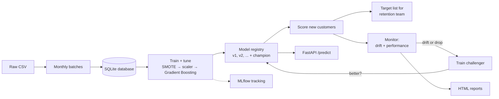

# Customer Churn Prediction: an end-to-end MLOps project

Predicts which telecom customers are likely to leave, decides who should get a retention offer to make the most money, and keeps the model healthy over time: monitoring for data drift and performance drops, retraining automatically, and promoting a new model only when it is proven better.

Everything runs locally on one machine. No cloud account needed.

## What it does



Each simulated month:

1. **Ingest.** New customers arrive and are validated and stored, with no churn labels yet.
2. **Score.** The champion model scores them and writes a ranked target list (`reports/targets_month_XX.csv`).
3. **Monitor.** Each feature is compared with the data the model learned from, using the Population Stability Index.
4. **Labels arrive.** At month end we learn who actually churned.
5. **Evaluate.** PR-AUC, recall and precision are measured, along with the **money the campaign saved compared with contacting customers at random**.
6. **Decide.** If features drifted or PR-AUC dropped, a challenger is trained on the latest data. Both models are compared on customers neither has seen, and the challenger replaces the champion only if it wins.

## Quick start

```bash
python3 -m venv .venv
source .venv/bin/activate
make install                 # once
# put the dataset at data/raw/Customer Churn.csv
make test                    # all tests should pass
make simulate                # the whole pipeline end to end, about 2 minutes
open reports/summary.html    # the results
```

Then try:

| Command | What you get |
|---|---|
| `make status` | Model versions and month-by-month monitoring in the terminal |
| `make api` | API at http://localhost:8000/docs. Try `/predict` in the browser. |
| `make install-mlflow` then `make mlflow` | Every training run and month at http://localhost:5000 |
| `make score IN=new.csv OUT=scores.csv` | Score your own CSV with the champion |
| `make check-features` | How much the model relies on `status` and `customer_value` |
| `make docker-build` then `make docker-run` | The API in a container, with Docker installed |

## Results

**Model** (Gradient Boosting, 5-fold CV tuning, held-out test set of 855 customers):

| ROC-AUC | PR-AUC | Churn recall | Churn precision |
|---|---|---|---|
| 0.976 | 0.896 | 0.91 | 0.71 |

**Simulation:** see `reports/summary.html` after `make simulate`. It shows each month's PR-AUC, data drift, retraining decisions and campaign profit compared with random targeting.

Dataset: [Iranian Churn Dataset](https://archive.ics.uci.edu/dataset/563/iranian+churn+dataset) (UCI, CC BY 4.0). It has 3,150 records, 2,850 after removing duplicates. Features are aggregated over the first 9 months, and churn is measured at month 12.

## Design decisions

- **Fixes from the original university notebook.** 300 duplicate rows are removed before splitting, since copies of the same customer previously ended up in both train and test. SMOTE runs inside an `imblearn` Pipeline, so oversampling never touches validation or test data. Tuning optimises PR-AUC rather than accuracy, which misleads on 16% churn. KNN's `k` is no longer chosen on the test set.
- **Threshold chosen by money, not 0.5.** The cut-off maximises `saved value − offer cost` on out-of-fold predictions. Offer cost and save rate are set in `config.yaml`.
- **PSI for drift.** It's simple, explainable and widely used in industry (credit risk, telecom). A PSI above 0.2 counts as drift.
- **Retraining reuses the champion's hyperparameters.** This is fast enough to run every month. Full re-tuning is a deliberate, manual step (`make train`).
- **Fair champion-vs-challenger comparison.** Both models are scored only on customers who arrived after the champion was trained, held out from the challenger's training as well.
- **Simulated drift.** The dataset is a single snapshot, so from month 4 customer behaviour is changed on purpose (more call failures, less usage, complaints that don't lead to churn). This gives the monitoring something real to catch.

## Project structure

```
churn-mlops/
├── config.yaml              all settings: paths, tuning grid, business costs, drift thresholds
├── Makefile                 every command (make help)
├── Dockerfile               the API in a container
├── data/raw/                Customer Churn.csv goes here (not committed)
├── notebooks/               original exploration and model comparison
├── scripts/                 one-off analyses
├── src/churn/
│   ├── data.py              load, clean, validate
│   ├── pipeline.py          SMOTE → scaler → Gradient Boosting
│   ├── train.py             tuning, profit-based threshold, evaluation
│   ├── business.py          campaign profit vs random targeting
│   ├── db.py                SQLite: customers, predictions, monitoring, model events
│   ├── registry.py          model versions and champion
│   ├── monitor.py           data drift (PSI, KS test)
│   ├── cycle.py             the monthly ingest → score → monitor → retrain loop
│   ├── simulation.py        replays the dataset month by month
│   ├── report.py            HTML reports
│   ├── tracking.py          MLflow logging (optional)
│   ├── api.py               FastAPI service
│   └── cli.py               command line entry point
└── tests/                   pytest, on synthetic data
```

## Limitations

- One company's anonymised snapshot, with no real time dimension. The monthly arrival and the drift are simulated.
- `customer_value` is used both as a feature and as the value at risk in the profit calculation, which is a simplification.
- `status` (active/inactive) is the strongest feature. It is measured before churn (months 1–9 vs month 12), so it is not leakage, but the model leans on it heavily. `make check-features` quantifies this.
- Business numbers (offer cost, save rate) are assumptions in `config.yaml`, not company data.
